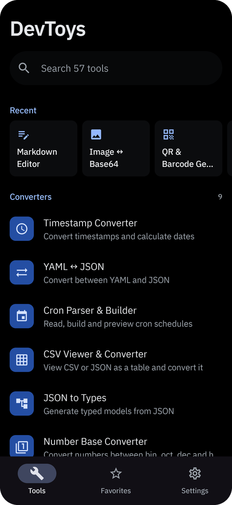
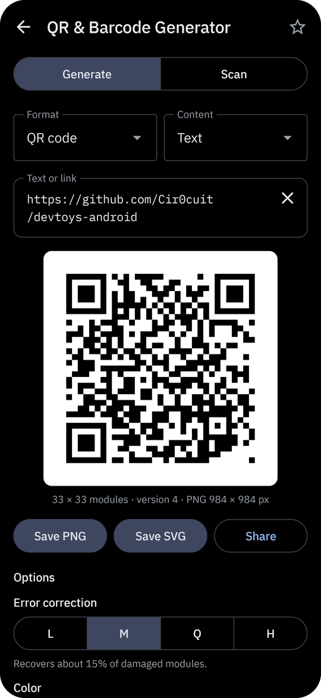
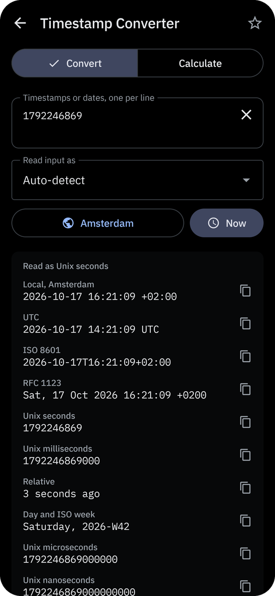
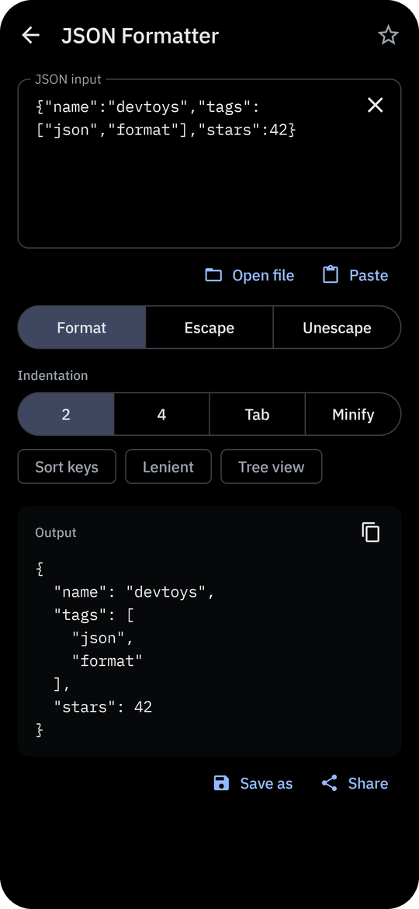
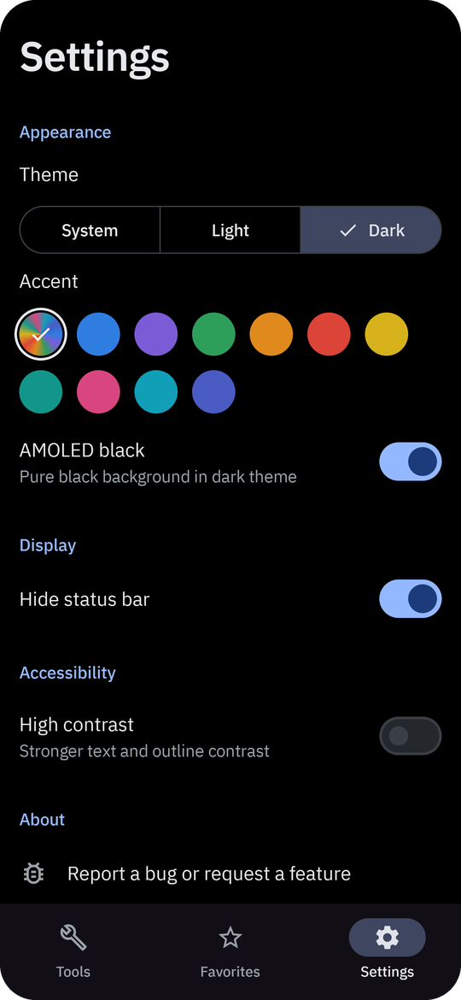

<div align="center">


# DevToys for Android

**57 offline developer tools in one app**

Decode a JWT, check a subnet, format JSON or generate a UUID on your phone,
without pasting your data into a website.

[](https://github.com/Cir0cuit/devtoys-android/actions/workflows/ci.yml)


[**Download**](https://github.com/Cir0cuit/devtoys-android/releases/latest) · 57 tools · no network access


</div>

---

## Why

A developer, IT admin or tinkerer often needs to decode a JWT, check a subnet, format some JSON or generate a UUID, and usually has to paste the data into a website to do it. DevToys for Android puts those tools on your phone and keeps the data there. Everything runs on the device. The app has no INTERNET permission, so nothing you paste into it can leave your phone.

DevToys for Android is an independent Android adaptation of [DevToys](https://github.com/DevToys-app/DevToys), the MIT-licensed developer toolbox for Windows, macOS and Linux. It is not affiliated with or endorsed by the DevToys project and shares no code with it.

## Highlights

- **Offline and private:** no network access, no runtime permissions, no ads, no subscriptions, no telemetry, no analytics.
- **57 tools** in eight categories, with ranked search, favorites and recently used tools.
- **Share and open files:** send text, images or files to DevToys from other apps, or open `.json`, `.xml`, `.yaml`, `.csv`, `.sql`, `.md`, `.pem`, `.gz` and other files from a file manager. DevToys opens the tool that handles them.
- **Results as you type:** most tools update live, keep your input per tool and restore it after rotation or a restart. Passwords, keys and tokens are never saved.
- **Themes:** system, light or dark mode, AMOLED black, eleven accent colors including dynamic color, and a high-contrast mode.
- **Open source:** Apache-2.0, built with Kotlin and Jetpack Compose.

## Screenshots

<p>
  
  
  
  
  
</p>

## Tools

Every result can be copied. Tools that produce files can save them through the system file picker or share them to another app.

### Converters

- **Timestamp Converter:** converts many timestamps at once. Detects Unix seconds, milliseconds, microseconds and nanoseconds, .NET ticks, ISO 8601 and RFC 1123, or reads a forced epoch: Windows FILETIME/LDAP, WebKit, Cocoa, HFS+, GPS, Excel 1900/1904 and FAT/DOS. Shows local time, UTC, ISO 8601, RFC 1123, relative time and ISO week in any time zone. Calculate mode gives the difference between two dates (calendar, totals and business days) and adds ISO 8601 durations.
- **Cron Parser & Builder:** reads and builds Unix, Spring, Quartz, cron4j and AWS EventBridge expressions. Describes them in plain English, lists up to 100 next and previous runs in any time zone, and points at the field that is out of range. Copies the schedule as a crontab line, Kubernetes CronJob, GitHub Actions schedule, Spring `@Scheduled` or systemd timer.
- **Number Base Converter:** converts between decimal, hex, binary, octal and any base from 2 to 36, with 8/16/32/64-bit two's complement, signed and unsigned views, digit grouping and big- and little-endian bytes.
- **Unit Converter:** data size (SI and IEC), data rate, time (including ISO 8601 durations), temperature, length, mass, speed, volume, area, pressure and energy. Shows the value in every unit at once.
- **Math Evaluator:** evaluates expressions with 128-bit precision. Supports hex, binary and octal literals, bitwise operators, powers, `pi`, `e` and common functions (square root, logarithms, trigonometry, rounding, min and max). Whole results are also shown in hex, binary and octal.
- **JSON to Types:** generates models from JSON for Kotlin (kotlinx.serialization, Moshi, Gson or plain), TypeScript, Swift, Go, Java records, Python dataclasses, C#, Dart and Rust. Merges array items, so missing keys become optional, and adds rename annotations where names differ.
- **YAML ↔ JSON:** converts both ways using the YAML 1.2 core schema, so `yes`, `no` and dates stay strings. Handles multi-document YAML, merge keys, sorted keys and custom indentation, and quotes strings that YAML would read as another type.
- **XML ↔ JSON:** converts both ways. Attributes become `@name` and text becomes `#text`, repeated elements become arrays, and invalid element names are reported.
- **CSV Viewer & Converter:** shows CSV, TSV or JSON as a table with an auto-detected or chosen delimiter and an optional header row. Exports to CSV, Markdown, HTML, JSON (optionally with typed values) or SQL `INSERT` statements.

### Encoders & decoders

The text encoders share a few behaviours. They encode and decode live and can send the result back the other way. When decoded data is not text, they show a hex dump, name the detected file type (PNG, JPEG, PDF, ZIP and others) and can save the bytes.

- **Base64 Encoder / Decoder:** standard or URL-safe alphabet, with optional padding and 76-character lines. Decoding accepts either alphabet, missing padding, whitespace and `data:` URIs.
- **Base32 / Base58 / Base85:** Base32, Base32hex, Base58 (Bitcoin), Ascii85, Z85 and Base36.
- **URL Encoder / Decoder:** encodes as a URL component, a full URL or form data. Decodes repeatedly for double-encoded input and warns about broken escapes. Parse mode splits a URL into its parts and query parameters and removes tracking parameters such as `utm_*` and `fbclid`.
- **HTML Entity Encoder:** escapes and unescapes named and numeric entities. Includes a searchable reference of named entities and emoji that copies the symbol or its code.
- **Hex Encoder / Decoder:** plain, spaced, colon-separated, `\x` escapes, `0x` lists, C, Kotlin and Python byte arrays, or a full hex dump.
- **GZip / Deflate:** compresses text or files to GZip, Zlib or raw Deflate as Base64 or hex, and decompresses with automatic format detection. Shows the compression ratio and saves the result. Handles files up to 16 MB.
- **ROT13 / Classic Ciphers:** Caesar with any shift (and a ranked view of all 25), ROT13, ROT47, ROT18, Atbash, Vigenère and repeating-key XOR.
- **JWT Decoder:** finds JWTs anywhere in pasted text and decodes the header and claims, with readable dates and warnings for `alg: none` or a missing expiry. Verifies HS, RS, PS, ES and EdDSA signatures with a secret, PEM key, certificate or JWK set. Also creates and signs new tokens.
- **Basic Auth Header:** builds an `Authorization: Basic` header and a matching curl option, or decodes one back to a username and password.

### Formatters

- **JSON Formatter:** formats with 2 or 4 spaces or tabs, minifies, sorts keys and validates, with errors given by line and column. Lenient mode accepts comments, single quotes and unquoted keys. Also escapes text into a JSON string and back. Has a collapsible tree view where tapping a value copies it and a long press copies its JSONPath.
- **XML Formatter:** formats and minifies XML and runs XPath 1.0 queries. Rejects external entities and internal DTDs.
- **SQL Formatter:** formats with one clause per line and indented joins, subqueries and `CASE`, or minifies. Changes keyword case and warns about unclosed strings and comments.

### Generators

- **UUID Generator:** generates v1, v3, v4, v5, v7, nil and max UUIDs in batches of up to 100. Formats them plain, braced, as URNs, Base64 or a JSON array. Decodes a UUID to show its version, variant and embedded time.
- **ID & Token Generator:** ULID, NanoID with any alphabet, Snowflake (Discord or Twitter epoch), KSUID and random tokens in hex, Base64, Base32 or Base58, with an entropy and collision estimate. Inspect mode identifies and decodes UUIDs, ObjectIds, ULIDs, KSUIDs and Snowflakes.
- **Password Generator:** passwords with selectable character sets, no look-alikes and minimum counts; passphrases from the EFF word list; and PINs that avoid trivial sequences. Shows entropy and an estimated crack time.
- **QR & Barcode Generator:** generates QR, Data Matrix, Aztec, PDF417, Code 128, Code 39, Code 93, EAN-13, EAN-8, UPC-A, UPC-E, ITF and Codabar codes. Templates cover links, Wi-Fi, contacts, email, SMS, phone, location and calendar events. Options include error correction, colors, quiet zone and size. Saves as PNG or SVG. Scans codes from a photo or picture and offers matching actions, such as opening a link, joining a Wi-Fi network or adding a contact.
- **Lorem Ipsum Generator:** words, sentences, paragraphs or an exact number of characters, as plain text, HTML or a JSON array.

### Cryptography

- **Hash / Checksum:** MD5, SHA-1, SHA-224, SHA-256, SHA-384, SHA-512, CRC32, CRC32C and Adler-32 for text, hex, Base64 or several files at once. Compares against a given checksum and verifies `sha256sum`-style checksum files.
- **HMAC Calculator:** HMAC-MD5, SHA-1, SHA-256 and SHA-512 with text, hex or Base64 keys and messages. Verifies a signature in constant time, including webhook formats such as `sha256=`.
- **OTP Generator:** TOTP and HOTP codes from a Base32 secret or an `otpauth://` URI, with a countdown, previous and next codes, and a code checker that tolerates one step of clock drift.
- **Text Encryption:** AES-GCM or AES-CBC with a password (PBKDF2) or a raw key. CBC output is compatible with `openssl enc -aes-256-cbc -pbkdf2`.
- **Key Pair Generator:** RSA 2048 to 4096 and EC P-256 to P-521 keys as OpenSSH, PEM (SPKI and PKCS#8) and JWK, with the SSH fingerprint.
- **X.509 Certificate Decoder:** reads PEM, DER and PKCS#7 certificates and chains. Shows subject, alternative names, issuer, validity, key, key usage, fingerprints and public key pin. Exports as PEM or DER.

### Text

- **Case Converter:** shows the text in 19 cases at once, including camelCase, PascalCase, snake_case, kebab-case, CONSTANT_CASE, Train-Case, dot.case, slug and an accent-free ASCII version. Detects the input's case.
- **Line Tools:** sort (alphabetical, natural, by length or ignoring case), reverse, shuffle, remove or keep duplicates, count occurrences, filter by text or regex, join or split, trim, number, convert tabs and line endings, and remove a BOM.
- **Text Comparer:** compares two texts line by line, highlighting changed words or characters. Can ignore case, whitespace or blank lines, and exports a unified diff that `git apply` accepts.
- **JSON Diff:** compares two JSON documents by structure, regardless of key order and optionally of array order, and lists every change with its JSONPath.
- **List Comparer:** shows what is in both lists, only in one of them, or in either.
- **Regex Tester:** tests Java regular expressions with flags, highlighted matches and groups, and replace and split modes. Warns about runaway backtracking. Copies the pattern as Kotlin, Java, JavaScript, Python, Go or `grep` code.
- **Find & Replace:** plain or regex search with group references, case-insensitive and whole-word options, and highlighted replacements.
- **String Escape:** escapes and unescapes strings for JSON, Java, Kotlin, JavaScript, C#, Python, SQL, shell, CSV, regex and Unicode escapes. Gives the position of an invalid escape.
- **Text Statistics:** characters, code points, graphemes, words, sentences, lines, longest line, line-ending types, size in UTF-8, UTF-16 and Latin-1, reading time and the most frequent words.
- **Unicode Inspector:** shows each code point's name, category, block, UTF-8 and UTF-16 bytes and escapes. Highlights and removes invisible and direction-changing characters, and warns about mixed-script look-alikes. Also shows the NFC, NFD, NFKC and NFKD forms and an ASCII table.
- **Markdown Editor:** edits Markdown with a formatting toolbar and a live preview that supports tables, task lists and footnotes. Opens and saves `.md` files and exports to PDF or HTML. Includes a syntax cheatsheet.
- **Semver Compare:** compares and sorts versions by SemVer 2.0.0 and checks npm or Cargo ranges, explaining why a version does or does not match.

### Network & system

- **CIDR Calculator:** IPv4 and IPv6 subnet details: network, mask, wildcard, broadcast, host range and address type. Splits a network by prefix or by host counts (VLSM) and exports the result as CSV. Converts an address range to CIDR blocks, merges overlapping blocks, and tests which block an address belongs to.
- **IP Address Converter:** converts IPv4 and IPv6 between dotted, compressed, expanded, decimal, hex and binary forms. Shows the PTR name, address type and mapped, 6to4 and NAT64 forms, and generates a random ULA prefix.
- **MAC Address Lookup:** shows the address type, other notations, EUI-64 and link-local IPv6. Vendor names come from an IEEE `oui.txt` that you download from IEEE and import; the app ships none. Extracts every MAC address from pasted `arp` or `ip neigh` output.
- **Chmod Calculator:** converts between octal, symbolic, `ls -l` and chmod expressions such as `u+x,go-w`, including setuid, setgid and sticky bits. Works out umask defaults and the umask needed for a given mode.
- **Well-Known Ports:** searchable list of common TCP and UDP ports, plus a random free port in the dynamic range.
- **HTTP Reference:** status codes with explanations and specs, HTTP methods and their properties, and common headers with examples.
- **MIME Types:** looks up MIME types by extension or name. Identifies a file's real type from its first bytes.
- **Cheatsheets:** about 300 commands for Git, Bash, SSH, tmux, systemd, curl, jq, OpenSSL, Docker, Kubernetes, Helm, Gradle, regex, Vim, SQL, ADB, npm and pip, and PowerShell. Commands with placeholders can be filled in before copying.
- **Device Information:** device model, Android version and patch level, screen, memory, locale and WebView user agent, which can be copied or shared as Markdown.

### Graphics

- **Color Converter:** reads hex, `rgb()`, `hsl()`, `hwb()`, `oklab()`, `oklch()` and CSS color names, or picks a color from an image with a magnifier. Converts it to HEX, RGB, HSL, HSV, HWB, CMYK, Lab, LCH, OKLab, OKLCH, Android, Compose and SwiftUI formats, and names the nearest CSS color.
- **Color Palette Generator:** builds complementary, analogous, triadic and monochromatic colors, a Tailwind-style 50–950 scale and palettes taken from an image. Exports as CSS variables, Tailwind config, Android `colors.xml`, Compose or design tokens.
- **Contrast Checker:** WCAG 2.x contrast ratio with AA, AAA and UI component checks. Can adjust the text color to pass, and simulates protanopia, deuteranopia and tritanopia.
- **Image ↔ Base64:** turns a picture or camera photo into Base64 or a data URI, and Base64 back into an image you can save or share.

## Using the app

- **Search:** every word you type must match. Tools whose name starts with the query rank first, then matches in the name, then matches in the description.
- **Favorites and recents:** star a tool from its top bar or long-press it in the list. The last six tools you opened appear at the top of the list.
- **Sharing into DevToys:** text, images and files shared from other apps open in the tool that handles them. If several tools can, DevToys asks which one to use.
- **Opening files:** DevToys appears in "Open with" for JSON, XML, YAML, SQL, CSV, Markdown, plain text, PEM and DER certificates and GZip files.
- **Settings:** theme, accent color, AMOLED black, high contrast and a hidden status bar. Settings also show the app's license, privacy policy and open source licenses.

## Install

Download `DevToys-<version>.apk` from the [latest release](https://github.com/Cir0cuit/devtoys-android/releases/latest) and open it on your device. You may need to allow installs from your browser or file manager. Requires Android 8.0 (API 26) or newer. Each release lists the APK's SHA-256 checksum in `SHA256SUMS.txt`.

Releases are signed with the certificate below. `apksigner verify --print-certs DevToys-<version>.apk` prints it as the `certificate SHA-256 digest`:

```
c9680cf469fc025144b51139198f5b1109e1cbbcc497b0d9da56ad9f757e000b
```

Updates are published as new releases. Installing a newer APK over the old one keeps your favorites and settings.

DevToys is no longer published on Google Play.

## Build from source

Requirements: JDK 17 to 21 and the Android SDK (API 35). Newer JDKs are not supported by the Gradle version in use, so point `JAVA_HOME` at a JDK 17-21 install if your default `java` is newer.

```sh
./gradlew assembleDebug
```

The APK is written to `app/build/outputs/apk/debug/`.

Tests and lint:

```sh
./gradlew testDebugUnitTest
./gradlew lintDebug
```

### Signed release builds

Release builds are minified with R8 and signed only when a keystore is configured. Create a
`keystore.properties` file in the project root (it is gitignored):

```properties
storeFile=path/to/release.jks
storePassword=...
keyAlias=...
keyPassword=...
```

Alternatively set `DEVTOYS_KEYSTORE_FILE`, `DEVTOYS_KEYSTORE_PASSWORD`,
`DEVTOYS_KEY_ALIAS` and `DEVTOYS_KEY_PASSWORD`. Then run:

```sh
./gradlew assembleRelease
```

Without a keystore, `assembleRelease` produces an unsigned APK. Release builds are reproducible: building the same tag gives a byte-identical APK apart from the signature.

## Project structure

- `app/`: `MainActivity`, the main screen and tool host, settings, favorites, share and open-file handling, privacy policy text.
- `core/designsystem/`: theme, colors and the bundled IBM Plex fonts.
- `core/ui/`: shared composables such as `ToolScaffold`, `MonoTextField`, `SelectField` and `OutputPanel`.
- `tools/base/`: the `Tool` interface, `ToolDescriptor`, `ToolCategory` and the tool registry.
- `tools/<group>/`: one file per tool, grouped as `encoders`, `text`, `data`, `generators`, `crypto`, `developer` and `reference`. Unit tests (JUnit 4) live in each module's `src/test`.

### Adding a tool

1. Create a class implementing `Tool` in the matching `tools/<group>` module and give it a `ToolDescriptor` with an id, title, description, icon, category and search keywords.
2. If the tool can take content from other apps, set `accepts` (`ShareKind.TEXT`, `IMAGE`, `FILE`) and, for files it should open, `fileTypes` (extensions without the dot).
3. Register it in the `DefaultToolRegistry` list in `app/src/main/java/com/cir0cuit/devtoys/di/AppModule.kt`.
4. Keep pure logic in top-level `internal` functions and cover it with a JVM unit test.

## Privacy

DevToys follows a zero-data policy. It does not collect, log or transmit personal data, usage analytics, telemetry or crash reports, and it has no ads. All processing happens on your device. Content you share or open is passed only to the tool that handles it and is never stored elsewhere or transmitted. The app does not request the INTERNET permission or any runtime permission. The camera, photo picker and file access go through the system's own screens.

The full policy is shown in the app under Settings and is kept in [`app/src/main/java/com/cir0cuit/devtoys/ui/LegalTexts.kt`](app/src/main/java/com/cir0cuit/devtoys/ui/LegalTexts.kt).

## Contributing

Bug reports and feature requests are welcome in [GitHub Issues](https://github.com/Cir0cuit/devtoys-android/issues). Pull requests are welcome too. Please run `./gradlew testDebugUnitTest lintDebug assembleRelease` before opening one. New dependencies must be actively maintained, Apache-2.0, MIT or BSD compatible, and available from Maven Central or Google.

## License

DevToys for Android is licensed under the [Apache License 2.0](LICENSE).

### Third-party libraries

The app's Settings list every library in the APK with its license.

- AndroidX, Jetpack Compose and Material 3, Hilt and Dagger, Kotlin and kotlinx: Apache-2.0
- [AboutLibraries](https://github.com/mikepenz/AboutLibraries): Apache-2.0
- [Gson](https://github.com/google/gson): Apache-2.0
- [SnakeYAML](https://bitbucket.org/snakeyaml/snakeyaml): Apache-2.0
- [Markwon](https://github.com/noties/Markwon): Apache-2.0
- [commonmark-java](https://github.com/commonmark/commonmark-java) 0.13: BSD-2-Clause
- [cron-utils](https://github.com/jmrozanec/cron-utils): Apache-2.0, with [SLF4J API](https://www.slf4j.org/): MIT
- [JSON-java (org.json)](https://github.com/stleary/JSON-java): Public Domain
- [ZXing](https://github.com/zxing/zxing): Apache-2.0
- [java-diff-utils](https://github.com/java-diff-utils/java-diff-utils): Apache-2.0

### Bundled fonts and data

- IBM Plex Sans and IBM Plex Mono, © IBM Corp., SIL Open Font License 1.1 ([core/designsystem/FONTS-LICENSE.txt](core/designsystem/FONTS-LICENSE.txt)).
- EFF Large Wordlist for passphrases, © Electronic Frontier Foundation, CC BY 3.0 US.
- HTML named character references from the WHATWG HTML Standard, © WHATWG (Apple, Google, Mozilla, Microsoft), BSD 3-Clause License; emoji data from Unicode Emoji 15.0, © Unicode, Inc., Unicode License v3. Used in the HTML Entity Encoder.
